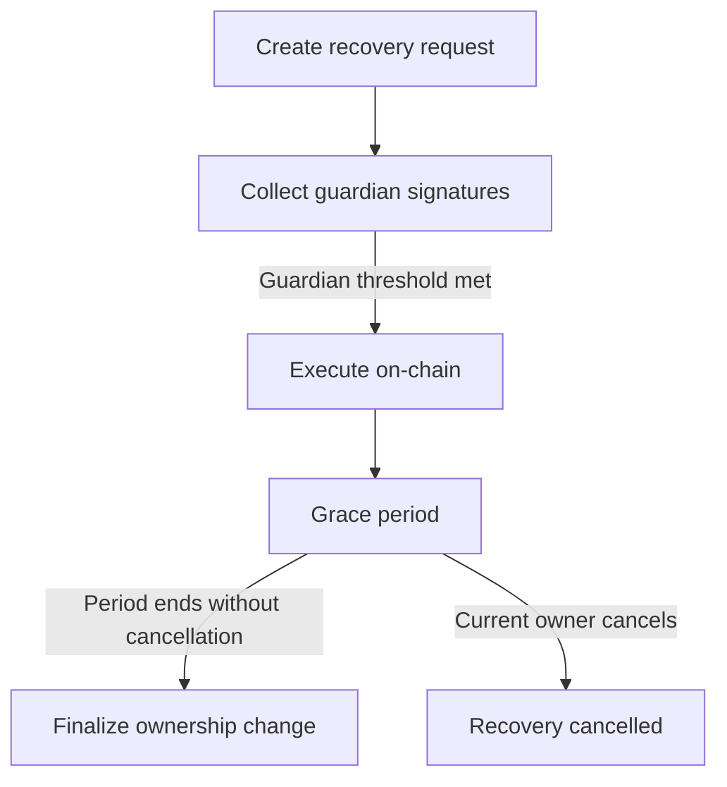

Candide's Safe Recovery Service helps wallets recover Safe accounts when users lose their signing keys. It works with the [Social Recovery Module](/wallet/plugins/recovery-with-guardians/), a contract on the Safe that lets guardians approve new owners through a signature threshold and a time delay.

The module enforces the rules on-chain. The service does the coordination around it: collecting guardian signatures, submitting transactions, verifying emails and phone numbers, and notifying owners.

## What It Gives Your Users

| Capability | What happens |
|------------|--------------|
| [Guardian approvals](/wallet/recovery/ux-api/) | Guardians sign a recovery request off-chain, without holding funds. The service stores the signatures until the threshold is met. Each request has an emoji sequence the guardian can check with the owner before signing. |
| [Email or SMS as a guardian](/wallet/recovery/auth-api/) | The user registers an email address or phone number. A guardian run by the service signs a recovery after the user confirms a one-time code. |
| [Alerts](/wallet/recovery/alerts/) | Owners get an email or SMS when a recovery is executed or their guardians change, whether it went through the service or directly on-chain. |
| [Paid gas](/wallet/recovery/ux-api/#execute-a-recovery-by-id) | The service can pay for the two recovery transactions, so neither guardians nor a user with a new key need funds. |
| [Find an account by email or phone](/wallet/recovery/find-accounts/) | A user who lost the device and does not know the account address verifies their email address and gets the list of their accounts. |
| [Recover an account that was never deployed](/wallet/recovery/undeployed-accounts/) | Optional. The service keeps what is needed to deploy a Safe that registered before its first transaction, and pays to deploy it when the user needs to recover. |

## How a Recovery Goes

1. **Create.** A guardian signs a request naming the new owners. The service stores it off-chain.
2. **Approve.** Other guardians sign until the account's guardian threshold is met.
3. **Execute.** Your application asks the service to submit the request on-chain. The grace period starts and subscribed owners are alerted.
4. **Wait.** During the grace period, an owner who still controls the account can cancel.
5. **Finalize.** Your application asks the service to finalize. The new owners take control only at this point.

The service never submits a step on its own. Your application triggers execution and finalization.

## What You Trust Candide With

- **One guardian key, if you use email/SMS recovery.** The guardian that signs after an email or SMS code is a key Candide holds. We recommend it as one guardian among several, for example 2-of-3 with your wallet's own guardian and a recovery contact. It can be the only guardian, but then Candide alone can recover the account. See [Choosing Guardians](/wallet/plugins/recovery-with-guardians/#choosing-guardians).
- **No access to funds.** A guardian cannot move assets or sign transactions for the account. It can only approve new owners, and that takes effect after the grace period.
- **A window to react.** The grace period, with alerts, gives an owner who still has the key time to cancel a recovery they did not ask for.
- **Coordination, not control.** With personal guardians, the service only stores signatures and submits transactions. The same recovery can be carried out on the module directly.

## Get Started

[Request service access](https://app.formbricks.com/s/brdzlw0t897cz3mxl3ausfb5), then follow the guide for your recovery method:

- **Personal guardians:** [Add a guardian](/wallet/plugins/how-to-add-a-guardian/), then follow the [Recovery Flow Guide](/wallet/plugins/recovery-flow-guide/).
- **Email/SMS:** [Enable email/SMS recovery](/wallet/plugins/add-candide-guardian/), then follow the [Email/SMS Recovery Flow](/wallet/plugins/recover-account-candide-guardian/).
- **Notifications:** Set up subscriptions with the [Recovery Alerts Guide](/wallet/plugins/recovery-alerts-guide/).
- **TypeScript integration:** Use the [Recovery Service SDK reference](/wallet/plugins/recovery-service-sdk-reference/).

## Reference Links

- [Recovery explainer](/blog/making-accounts-recoverable)
- [Social Recovery Module SDK reference](/wallet/plugins/recovery-module-reference/)
- [Module contracts and audits](https://github.com/candidelabs/candide-contracts)
- [Recovery Service source code](https://github.com/candidelabs/safe-recovery-service)
- [Recovery Service SDK source code](https://github.com/candidelabs/safe-recovery-service-sdk)
